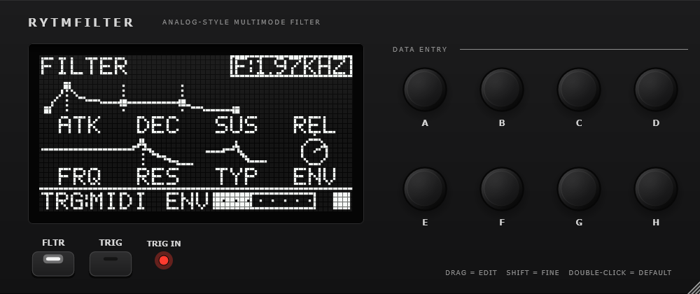
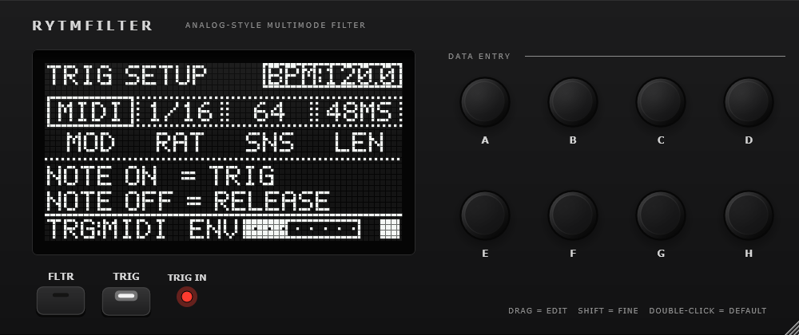

# RytmFilter – Anleitung

*Version 1.1*

## 1. Installation

Paket für dein System aus den [Releases](https://github.com/sscheppert-blip/RytmFilter/releases) laden und entpacken.
Du brauchst nur das Format, das deine DAW versteht (im Zweifel VST3).

| System | Paket | Formate |
|---|---|---|
| macOS 11 oder neuer, Apple Silicon | `RytmFilter-macOS-arm64.zip` | VST3 · AU · CLAP |
| Windows 10 / 11, x64 | `RytmFilter-Windows-x64.zip` | VST3 · CLAP |
| Linux amd64 (glibc 2.35+, z. B. Ubuntu 22.04, Debian 12, Fedora 36 oder neuer) | `RytmFilter-Linux-x64.zip` | VST3 · CLAP |

### macOS (Apple Silicon)

| Datei | Zielordner |
|---|---|
| `RytmFilter.vst3` | `~/Library/Audio/Plug-Ins/VST3/` |
| `RytmFilter.component` (AU, z. B. für Logic) | `~/Library/Audio/Plug-Ins/Components/` |
| `RytmFilter.clap` | `~/Library/Audio/Plug-Ins/CLAP/` |

`~/Library` ist im Finder versteckt: *Gehe zu → Gehe zu Ordner…* und den Pfad einfügen.

Die Plugins sind nicht bei Apple notarisiert. Damit macOS sie lädt, einmal im Terminal ausführen:

```sh
xattr -dr com.apple.quarantine ~/Library/Audio/Plug-Ins/VST3/RytmFilter.vst3 \
  ~/Library/Audio/Plug-Ins/Components/RytmFilter.component ~/Library/Audio/Plug-Ins/CLAP/RytmFilter.clap
```

### Windows 10 / 11 (x64)

| Datei | Zielordner |
|---|---|
| `RytmFilter.vst3` (ganzer Ordner) | `C:\Program Files\Common Files\VST3\` |
| `RytmFilter.clap` | `C:\Program Files\Common Files\CLAP\` |

Zum Kopieren in diese Ordner sind Administratorrechte nötig. Eine zusätzliche Laufzeit
(Visual-C++-Redistributable) wird nicht gebraucht. Falls Windows SmartScreen warnt:
*Weitere Informationen → Trotzdem ausführen*.

### Linux (amd64)

| Datei | Zielordner |
|---|---|
| `RytmFilter.vst3` (ganzer Ordner) | `~/.vst3/` |
| `RytmFilter.clap` | `~/.clap/` |

Ordner ggf. vorher anlegen (`mkdir -p ~/.vst3 ~/.clap`).

Danach die DAW neu starten bzw. die Plugin-Liste neu einlesen.

### Projekte aus Version 1.0

Werden beim Laden automatisch übernommen. FRQ arbeitet seit 1.1 in Halbtönen; der alte Wert wird auf den
nächstgelegenen Halbton derselben Frequenz umgerechnet (höchstens einen halben Halbton daneben).

---

## 2. Bedienung

Links das Display, darunter die Tasten **FLTR** und **TRIG** zum Umschalten der Seiten, rechts acht
Endlos-Regler **A–H**. Was ein Regler gerade macht, steht im Display an der gleichen Stelle. Wie am Original
haben die Regler keine Markierung – der Wert steht im Display. Alle Werte laufen in ganzen Schritten von 0 bis 127.

| Aktion | Wirkung |
|---|---|
| Regler ziehen (hoch/runter oder links/rechts) | Wert ändern |
| **Shift** gedrückt halten | Feineinstellung |
| Doppelklick auf Regler | zurück auf Standardwert |
| Fensterecke unten rechts ziehen | Fenster vergrößern/verkleinern (60–250 %) |

Beim Drehen zeigt das Display kurz den genauen Wert an. Die Fenstergröße merkt sich das Plugin im Projekt.

---

## 3. Seite FLTR – der Filter



| Regler | Name | Bereich | Was passiert |
|---|---|---|---|
| A | **ATK** | 0–127 | Attack: wie schnell die Hüllkurve hochfährt |
| B | **DEC** | 0–127 | Decay: wie schnell sie danach auf den Sustain-Pegel fällt |
| C | **SUS** | 0–127 | Sustain: Pegel, solange die Note gehalten wird |
| D | **REL** | 0–127 | Release: Ausklingen nach dem Loslassen |
| E | **FRQ** | 0–127 | Grundfrequenz des Filters in **Halbtonschritten**: 60 = 440 Hz (A4), 12 Schritte = eine Oktave (13,75 Hz … 21,1 kHz) |
| F | **RES** | 0–127 | Resonanz – betont die Filterfrequenz. Ab etwa **96** schwingt der Filter von selbst (siehe unten) |
| G | **TYP** | 7 Typen | Filtertyp (siehe unten) |
| H | **ENV** | −64 … +63 | Wie stark die Hüllkurve den Filter bewegt. Plus = öffnet, Minus = schließt |

Oben rechts im Display steht **live die aktuelle Filterfrequenz** – also FRQ plus das, was die Hüllkurve gerade
dazutut. Die Kurve in der Mitte zeigt, welche Frequenzen durchkommen.

### Selbstoszillation

Ab RES 96 pfeift der Filter von selbst – auch ganz ohne Eingangssignal entsteht ein sauberer Sinuston auf der
Filterfrequenz (bei RES 127 etwa −6 dBFS). Weil FRQ in Halbtönen arbeitet, lässt sich der Ton direkt stimmen:
FRQ 60 = A, FRQ 48 = A eine Oktave tiefer. Mit ENV und einer kurzen Hüllkurve entstehen so Kicks, Toms und Zaps.
Bei Bandsperre (BS) und Glocke (PK) gibt es keine Selbstoszillation.

> **Vorsicht:** Bei hoher Resonanz kann es laut werden – erst die Lautstärke runter, dann RES hochdrehen.

### Filtertypen

| Kürzel | Name | Klang |
|---|---|---|
| **LP2** | Tiefpass, steil | Klassischer „Höhen weg“-Filter, deutlich und satt |
| **LP1** | Tiefpass, sanft | Wie LP2, aber weicher – gut zum dezenten Abdunkeln |
| **BP** | Bandpass | Nur ein Frequenzband bleibt übrig – telefonartig, nasal |
| **HP1** | Hochpass, sanft | Bässe sanft ausdünnen |
| **HP2** | Hochpass, steil | Bässe kräftig wegschneiden |
| **BS** | Bandsperre (Kerbe) | Höhlt ein Band aus. Bei RES 0 am breitesten, mit mehr RES schmaler |
| **PK** | Glocke (Peak) | Hebt ein Band an. RES bestimmt, wie stark und wie schmal |

---

## 4. Seite TRIG – was die Hüllkurve auslöst



| Regler | Name | Was passiert |
|---|---|---|
| A | **MOD** | Auslöser: **MIDI**, **TRNS** (Transienten) oder **SYNC** (Songtempo) |
| B | **RAT** | Nur bei SYNC: Takt-Raster von 1/32 bis 4 Takte |
| C | **SNS** | Nur bei TRNS: Empfindlichkeit – höher = reagiert auf leisere Schläge |
| D | **LEN** | Bei TRNS/SYNC: wie lange die „Note“ gehalten wird (5 ms … 2 s) |

- **MIDI** – Die Hüllkurve startet bei jeder MIDI-Note und geht beim Loslassen ins Release. Dazu der Spur mit
  dem Plugin MIDI schicken (z. B. in Ableton: eine MIDI-Spur anlegen und deren Ausgang auf die Audiospur mit
  RytmFilter legen).
- **TRNS** – Das Plugin hört selbst auf das Audiosignal und startet bei jedem Schlag (Kick, Snare …).
- **SYNC** – Die Hüllkurve startet im eingestellten Raster, sobald die DAW läuft.

Die rote **TRIG IN**-LED und das Kästchen unten rechts im Display blinken bei jedem Auslösen. Die Leiste
„ENV“ zeigt den aktuellen Hüllkurvenpegel.

> **Hinweis:** ENV auf 0 = die Hüllkurve hat keine Wirkung. Für den typischen „Wow“-Effekt FRQ eher niedrig und
> ENV ins Plus drehen.

---

## 5. Rezepte zum Ausprobieren

| Ziel | Einstellung |
|---|---|
| Pumpende Bassline | LP2 · FRQ 44 · RES 60 · ENV +40 · DEC 50 · SUS 0 · MOD MIDI |
| Drum-Loop „atmen“ lassen | LP2 · FRQ 63 · ENV +35 · MOD TRNS · SNS 70 · DEC 45 |
| Rhythmisches Wah | BP · FRQ 54 · RES 70 · ENV +45 · MOD SYNC · RAT 1/8 |
| Dünner Hi-Hat-Teppich | HP2 · FRQ 87 · RES 20 · ENV 0 |
| Phaser-artiges Aushöhlen | BS · FRQ 72 · RES 30 · ENV −30 · MOD SYNC · RAT 1/4 · REL 80 |
| Filter-Kick (Selbstoszillation) | LP2 · FRQ 30 · RES 110 · ENV +40 · ATK 0 · DEC 30 · SUS 0 · MOD TRNS |

---

## 6. Selbst bauen (für Entwickler)

Voraussetzungen: CMake ≥ 3.28, ein C++17-Compiler, Internet beim ersten Konfigurieren (JUCE und
CLAP-Erweiterungen werden automatisch geladen).

```sh
cmake -S . -B build -DCMAKE_BUILD_TYPE=Release
cmake --build build --config Release
```

Optional: `-DJUCE_DIR=<pfad>` für einen lokalen JUCE-Checkout, `-DRYTMFILTER_COPY_AFTER_BUILD=OFF` wenn die
Plugins nicht automatisch installiert werden sollen. Unter Linux werden die üblichen JUCE-Pakete
(ALSA, X11, Freetype …) benötigt – siehe `.github/workflows/build.yml`.
