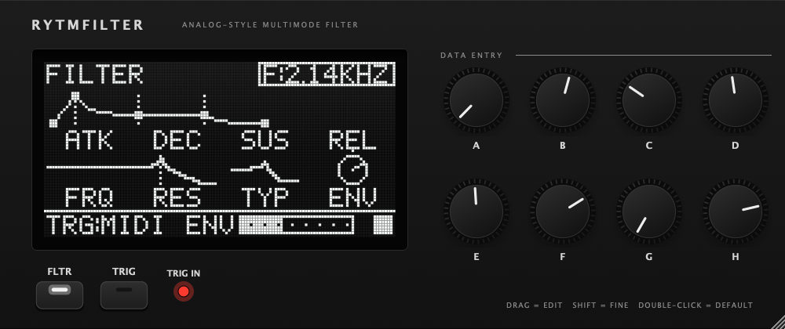
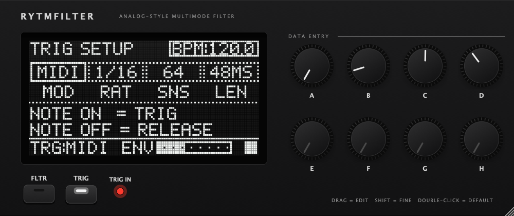

# RytmFilter

**Ein Filter-Plugin im Stil eines Hardware-Drumcomputers – mit Punktmatrix-Display, mattschwarzen Drehreglern und
einer Anzeige, die dir live verrät, bei welcher Frequenz der Filter gerade arbeitet.**

## Was ist das?

RytmFilter ist ein Audio-Effekt für deine Musiksoftware (DAW). Er formt den Klang wie die Filtersektion eines
klassischen Drumcomputers: Höhen wegnehmen, Bässe ausdünnen, eine Frequenz herausheben oder aushöhlen – und
das Ganze per Hüllkurve rhythmisch „atmen“ lassen.

Die Idee: Der schnelle Workflow einer Hardware-Kiste, aber direkt im Rechner. Acht Regler, ein Display,
alle Werte von 0 bis 127 – kein Menü-Labyrinth.

## Was kann es?

- **7 Filtertypen** – Tiefpass (zwei Varianten), Bandpass, Hochpass (zwei Varianten), Kerbfilter und Glocke
- **Resonanz** – vom sanften Abrunden bis zum pfeifenden Zwitschern
- **Hüllkurve** – lässt den Filter auf- und zugehen, ausgelöst durch MIDI-Noten, durch Schläge im Audiosignal
  oder automatisch im Songtempo
- **Live-Frequenzanzeige** – oben im Display steht, wo der Filter gerade greift (z. B. `F:2.14KHZ`),
  daneben ein Bild der Filterkurve, das sich mitbewegt
- **Frei skalierbar** – das Fenster lässt sich stufenlos vergrößern und bleibt dabei gestochen scharf.
  Gut für müde Augen.

## Wo läuft es?

| System | Formate |
|---|---|
| macOS (Apple Silicon, ab macOS 11) | VST3 · AU · CLAP |
| Windows 10 / 11 (64 Bit) | VST3 · CLAP |
| Linux (64 Bit) | VST3 · CLAP |

## Herunterladen & loslegen

1. Unter **[Releases](../../releases)** das Paket für dein System laden.
2. Entpacken und die Plugin-Dateien in den Plugin-Ordner kopieren.
3. DAW neu starten bzw. Plugins neu einlesen lassen.

Wie genau das geht und was jeder Regler macht, steht in der **[Anleitung](ANLEITUNG.md)**.

## Gut zu wissen

- Das Projekt ist kostenlos und quelloffen (Lizenz: [AGPL-3.0](LICENSE)).
- Die Plugins sind nicht von Apple/Microsoft signiert. Beim ersten Start meckert das System eventuell – in der
  Anleitung steht, wie man das freigibt.
- RytmFilter ist ein Hobbyprojekt und klingt *inspiriert vom* Original, nicht identisch. Es ist kein offizielles
  Produkt und steht in keiner Verbindung zu Elektron. Alle Markennamen gehören ihren jeweiligen Inhabern.

## Wer steckt dahinter?

Gebaut von **[sscheppert-blip](https://github.com/sscheppert-blip)** zusammen mit **Claude** (KI-Assistent von
Anthropic) als Co-Autor, der den Großteil des Codes geschrieben hat.[^devlog]

[^devlog]: Für Neugierige: Wie das Plugin entstanden ist, welche Entscheidungen getroffen wurden und welche Bugs
    unterwegs aufgetaucht sind, steht im [Dev-Log](docs/DEVLOG.md).
